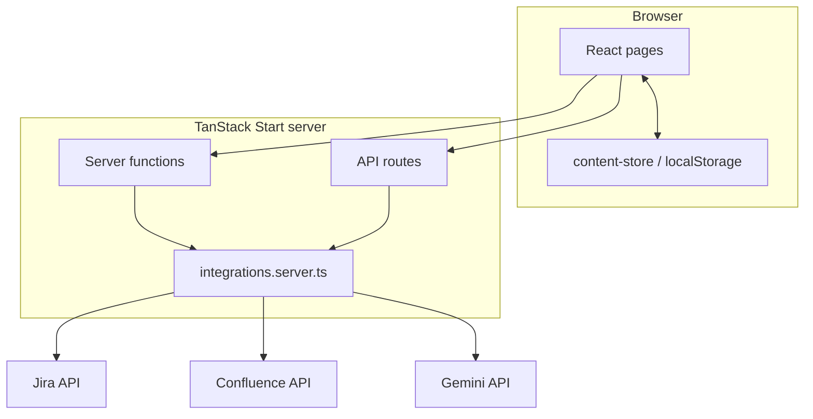

# Architecture Overview

> Language: EN | [Português (pt-BR)](../pt-BR/architecture/overview.md)
>
> Status: DRAFT
>
> Documentation Standard v1.0 (adopter)

## Purpose

High-level view of how AIOPS App Model is structured: UI layers, server-side integration boundary, and where data lives.

## Context

Single-repository TanStack Start app deployed via Lovable. File-based routes under `src/routes/`. Server logic colocated in `src/lib/*.server.ts` and exposed through TanStack Start server functions (`src/lib/integrations.functions.ts`) and API route handlers (`src/routes/api/`).

Evidence: `package.json`, `vite.config.ts`, `src/start.ts`, `src/server.ts`.

## Goals

| Goal | Notes |
| --- | --- |
| Discoverability | Browse projects, map, impact, integrations |
| Low-friction publishing | Import cases from Jira with Gemini assistance |
| Confluence alignment | Sync status reports into a scoped Confluence folder |
| Fast iteration | Lovable + Vite dev workflow |

## Non-Goals

| Non-goal | Rationale |
| --- | --- |
| Shared multi-user content store | Uses `localStorage`, not a central DB |
| Fine-grained access control | No auth middleware in codebase |

## System Boundary

| Inside the system | Outside the system |
| --- | --- |
| React UI, routing, client state | Atlassian Cloud (Jira/Confluence) |
| Server functions and API routes | Google Gemini API |
| SSR wrapper and CSRF middleware | Browser storage engine |
| Seed data modules in `src/data/` | Lovable build/runtime platform |

## External Actors

| Actor | Relationship | Notes |
| --- | --- | --- |
| Portal user | user | Reads portal pages |
| Admin user | user | Uses admin routes (unauthenticated) |
| Jira / Confluence | external system | REST APIs |
| Gemini | external system | Generative structuring of imports |

## Main Components

| Component | Responsibility | Documentation |
| --- | --- | --- |
| `src/routes/` | Pages and API handlers | [../application/routes.md](../application/routes.md) |
| `src/components/layout/` | Shell: sidebar, topbar, command palette | — |
| `src/components/portal/` | Portal presentation components | Phase 2 |
| `src/components/admin/` | Jira import, previews, admin forms | Phase 2 |
| `src/data/` | Typed seed content (cases, hub, integrations, …) | Phase 2 |
| `src/lib/content-store.ts` | Merge seed + `localStorage` | Phase 2 |
| `src/lib/integrations.server.ts` | Env loading, Atlassian/Gemini clients | Phase 2 |
| `src/lib/jira-case.server.ts` | Jira import pipeline | Phase 2 |
| `src/lib/confluence.server.ts` | Confluence sync (scoped folder) | Phase 2 |
| `src/lib/integrations.functions.ts` | Server function exports | Phase 2 |
| `src/server.ts` | SSR entry; normalizes catastrophic SSR errors | — |
| `src/start.ts` | CSRF + error middleware for server functions | — |

## Main Data Flows

| Flow | Source | Destination | Summary |
| --- | --- | --- | --- |
| Browse catalog | `src/data/` + `localStorage` | Portal pages | Client reads merged snapshot via hooks |
| Jira import | Jira REST + Gemini | `localStorage` case list | Admin form → server functions → draft case |
| Confluence sync | Case metadata | Confluence folder | Server function creates/updates HTML page |
| Jira media | Jira attachment API | Browser via proxy | GET `/api/jira-attachment?id=` |
| Search | Snapshot in memory | `/busca` results | `src/lib/search.ts` |

## Main Dependencies

| Dependency | Purpose | Failure impact | Classification |
| --- | --- | --- | --- |
| Atlassian APIs | Import and sync | Admin flows fail; media proxy errors | Confirmed |
| Gemini API | Case draft organization | Import returns unstructured/partial data | Confirmed |
| `localStorage` | Persist edits | Data loss if cleared; not shared across browsers | Confirmed |
| Lovable/Nitro runtime | SSR and deploy | App unavailable | Inferred |

## Security Boundaries

| Boundary | What is protected | Controls summary |
| --- | --- | --- |
| Atlassian credentials | API tokens | Environment variables only; Basic auth server-side |
| Server functions | Mutation endpoints | CSRF middleware on `serverFn` handlers (`src/start.ts`) |
| Confluence writes | Wiki content | Restricted to `CONFLUENCE_STATUS_FOLDER_ID` folder |
| End-user access | Admin routes | **No control implemented** — Confirmed gap |

## Failure Domains

| Domain | Includes | Failure effect |
| --- | --- | --- |
| Client storage | `localStorage` corruption/clear | Missing user-added cases |
| Atlassian outage | Jira/Confluence | Import/sync/proxy failures |
| Gemini quota/errors | AI organize step | Import pipeline degradation |
| SSR/runtime | Nitro/h3 errors | 500 HTML error page (`src/lib/error-page.ts`) |

## Architectural Constraints

| ID | Description | Source | Impact | Current Status |
| --- | --- | --- | --- | --- |
| CON-001 | Lovable-connected Git history must not be force-rewritten | `AGENTS.md` | Deployment/sync risk | Active |
| CON-002 | Confluence creates only under configured folder | `confluence.server.ts` | Limits blast radius | Active |
| CON-003 | UI copy in Brazilian Portuguese | Loft language standards | Documentation/code language split | Active |

## Trade-offs

| Decision / approach | Benefit | Cost |
| --- | --- | --- |
| `localStorage` for catalog | No backend DB; fast iteration | No shared source of truth across users |
| Server functions vs separate BFF | Colocated with UI; TanStack Start native | Tighter coupling; secrets on same runtime |
| Gemini for import structuring | Reduces manual case authoring | External dependency; non-deterministic output |

## Known Limitations

| Limitation | Impact | Classification |
| --- | --- | --- |
| No authentication | Anyone with URL can access admin | Confirmed |
| Per-browser content | Inconsistent catalog between users | Confirmed |
| Datadog / structured observability not evidenced | Harder production debugging | Unknown |

## Related Decisions

| ADR | Title | Status |
| --- | --- | --- |
| — | Planned Phase 2 | — |

## Related Documentation

| Document | Path |
| --- | --- |
| System context | [system-context.md](system-context.md) |
| Routes | [../application/routes.md](../application/routes.md) |
| Project overview | [../project-overview.md](../project-overview.md) |
| Local development | [../operations/local-development.md](../operations/local-development.md) |
