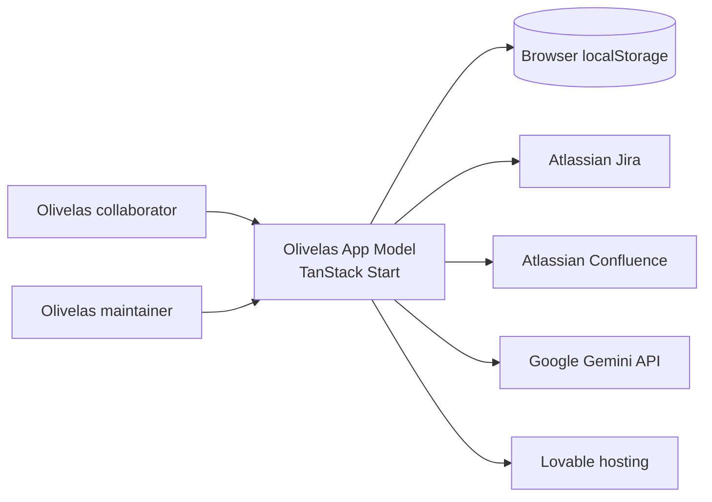

# System Context

> Language: EN | [Português (pt-BR)](../pt-BR/architecture/system-context.md)
>
> Status: DRAFT
>
> Documentation Standard v1.0 (adopter)

## Purpose

This document places Olivelas App Model in its ecosystem: who uses it, which external systems it calls, and what stays inside the application boundary.

## System

| Field | Value |
| --- | --- |
| Name | Olivelas App Model |
| Purpose | Internal Olivelas portal for AI project discovery, impact visibility, and case administration |
| Owner | Unknown — fill in Phase 2 (`operations/service-profile.md`) |
| Boundary summary | TanStack Start web app: React UI + server functions/API routes; browser-local catalog; outbound calls to Atlassian and Gemini |

## Users

| User | Need | Interaction |
| --- | --- | --- |
| Olivelas collaborator | Find AI projects, integrations, and impact stories | Browser — public portal routes |
| Olivelas / content maintainer | Import cases from Jira, sync Confluence status reports | Browser — admin routes |
| Developer | Run and extend the portal | Local dev server, Git |

## Consumers

| Consumer | What they consume | Contract |
| --- | --- | --- |
| Browser (portal UI) | HTML/JS SSR responses, server function JSON | TanStack Start |
| Jira (attachments/avatars) | Proxied binary responses | GET `/api/jira-attachment`, `/api/jira-avatar` |

## External Systems

| External system | Role | Direction | Classification |
| --- | --- | --- | --- |
| Atlassian Jira | Project/issue search, epic scope, attachments | outbound | Confirmed |
| Atlassian Confluence | List spaces; create/update/delete status pages in scoped folder | outbound | Confirmed |
| Google Gemini | Transform Jira scope into structured case draft | outbound | Confirmed |
| Lovable | Host build/deploy; error reporting hook | bidirectional | Confirmed |
| FastAPI backend (`VITE_API_URL`) | Referenced in `.env.example` | Unknown | Unknown |

## Dependencies

| Dependency | Type | Purpose | Classification |
| --- | --- | --- | --- |
| Browser `localStorage` | data | Persist portal content edits | Confirmed |
| Atlassian API credentials | operational | Authenticate Jira/Confluence calls | Confirmed |
| Gemini API key | operational | AI-assisted case organization | Confirmed |
| Nitro / Cloudflare (via Lovable) | runtime | SSR and server function hosting | Inferred |

## Inputs

| Input | Source | Format / contract |
| --- | --- | --- |
| Seed catalog | `src/data/*` | TypeScript modules |
| User edits / imports | Admin UI, Jira import | Merged into `PortalContentSnapshot` → `localStorage` |
| Jira project URL / epic scope | Admin import form | Server function POST body |
| Atlassian credentials | Environment / `.env` | Basic auth header |

## Outputs

| Output | Destination | Format / contract |
| --- | --- | --- |
| Portal pages | User browser | HTML (SSR) + client hydration |
| Confluence status pages | Confluence folder (`CONFLUENCE_STATUS_FOLDER_ID`) | Storage format HTML |
| Case drafts | Browser `localStorage` | JSON snapshot |
| Jira attachment/avatar bytes | Portal UI (img/src) | Binary HTTP response |

## Relevant Relations

| From | To | Relation | Notes |
| --- | --- | --- | --- |
| Olivelas App Model | Jira | calls | Search, scope collection, media proxy |
| Olivelas App Model | Confluence | calls | Writes limited to status folder |
| Olivelas App Model | Gemini | calls | Post-processing Jira scope |
| Olivelas App Model | localStorage | reads/writes | Per-browser content catalog |
| Admin user | Olivelas App Model | uses | No auth gate observed |

## Context Diagram

## Related Documentation

| Document | Path |
| --- | --- |
| Architecture overview | [overview.md](overview.md) |
| Routes | [../application/routes.md](../application/routes.md) |
| Local development | [../operations/local-development.md](../operations/local-development.md) |
| Project overview | [../project-overview.md](../project-overview.md) |
