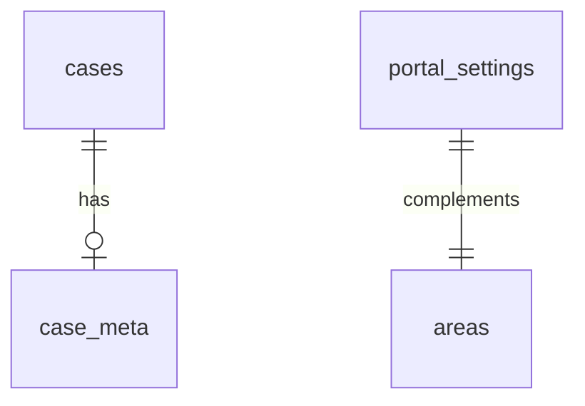

# Portal schema and API

> Language: EN | [Português (pt-BR)](../../pt-BR/backend/schema-and-api.md)
>
> Status: DRAFT
>
> Documentation Standard v1.0 (adopter)

Database schema and REST endpoints for persisting AIOPS App Model portal content (replacing browser `localStorage` over time).

## Schema `portal`

| Table | Purpose | Primary key |
| --- | --- | --- |
| `areas` | Map area labels | `name` |
| `cases` | AI project cases (full JSON document) | `id` |
| `case_meta` | Case metadata (Jira epic, gallery, …) | `case_id` |
| `integrations` | Integration catalog entries | `id` |
| `hub_content` | AI Hub posts/tutorials/news | `id` |
| `trilhas` | Learning tracks | `id` |
| `aulas` | Lessons | `id` |
| `portal_settings` | Singleton row for logos, aula status, deleted lists | `id=1` |
| `alembic_version` | Migration tracking | — |

Models: `backend/app/models/portal.py`

Complex nested fields are stored as **JSONB** in `payload` columns to match the frontend TypeScript types (`src/data/types.ts`).



## API prefix

Base URL: `VITE_API_URL` (default `http://localhost:8000`)

### Health

| Method | Path | Description |
| --- | --- | --- |
| GET | `/api/health/db` | PostgreSQL connectivity |

### Portal snapshot (bulk)

Mirrors `PortalContentSnapshot` from `src/lib/content-store.ts`.

| Method | Path | Description |
| --- | --- | --- |
| GET | `/api/v1/portal/snapshot` | Load full snapshot |
| PUT | `/api/v1/portal/snapshot` | Replace full snapshot |

### Cases

| Method | Path | Description |
| --- | --- | --- |
| GET | `/api/v1/cases` | List cases |
| GET | `/api/v1/cases/{id}` | Get case |
| POST | `/api/v1/cases` | Create case |
| PUT | `/api/v1/cases/{id}` | Upsert case |
| DELETE | `/api/v1/cases/{id}` | Delete case + meta |
| GET | `/api/v1/cases/{id}/meta` | Get case meta |
| PUT | `/api/v1/cases/{id}/meta` | Upsert case meta |

### Areas

| Method | Path | Description |
| --- | --- | --- |
| GET | `/api/v1/areas` | List area names |
| POST | `/api/v1/areas` | Create area |
| DELETE | `/api/v1/areas/{name}` | Delete area |

### Integrations

| Method | Path | Description |
| --- | --- | --- |
| GET | `/api/v1/integrations` | List |
| GET | `/api/v1/integrations/{id}` | Get |
| PUT | `/api/v1/integrations/{id}` | Upsert |
| DELETE | `/api/v1/integrations/{id}` | Delete |

### Hub content

| Method | Path | Description |
| --- | --- | --- |
| GET | `/api/v1/hub` | List |
| GET | `/api/v1/hub/{id}` | Get |
| PUT | `/api/v1/hub/{id}` | Upsert |
| DELETE | `/api/v1/hub/{id}` | Delete |

### External integrations (Jira, Confluence, Gemini)

Credentials: `JIRA_*`, `GEMINI_*`, `CONFLUENCE_STATUS_FOLDER_ID` in repository root `.env` or `backend/.env` (read by `backend/app/config.py`).

| Method | Path | Description |
| --- | --- | --- |
| GET | `/api/v1/diagnostics/integrations` | Test Jira, Confluence, Gemini connectivity |
| GET | `/api/v1/confluence/spaces` | List Confluence spaces |
| POST | `/api/v1/jira/issues/search` | Search project issues |
| POST | `/api/v1/jira/import` | Import case draft from Jira + Gemini |
| POST | `/api/v1/confluence/sync-case` | Create/update status page in Confluence |
| POST | `/api/v1/confluence/delete-case` | Delete status page in Confluence |
| GET | `/api/jira-avatar?u=...` | Proxy Jira avatar (512px upscale) |
| GET | `/api/jira-attachment?id=...` | Proxy Jira attachment content |

Frontend client: `src/lib/integrations-api.ts` (replaces TanStack server functions).

## Example — empty snapshot

```sh
curl -s http://localhost:8000/api/v1/portal/snapshot | jq .
```

## Example — create area

```sh
curl -s -X POST http://localhost:8000/api/v1/areas \
  -H 'Content-Type: application/json' \
  -d '{"name":"Engenharia"}'
```

## Migrations

```sh
cd backend
uv run python scripts/run_migrations.py
uv run python scripts/grant_app_privileges.py
```

## Seed sample data (optional)

```sh
cd backend
uv run python scripts/seed_portal.py
```

Skips seeding when cases already exist in the database.

## Related

- [rds-provisioning.md](rds-provisioning.md)
- [README.md](README.md)
