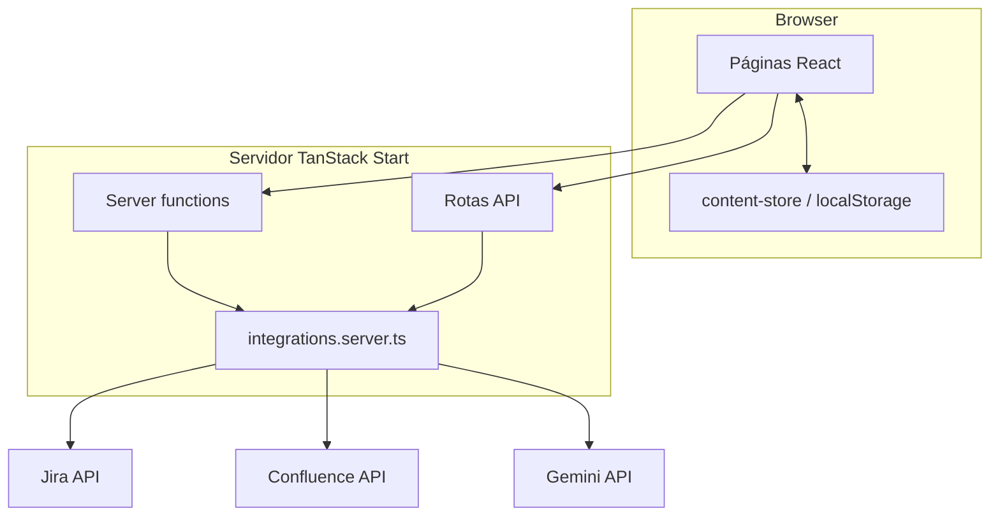

# Visão geral da arquitetura

> Language: [English (EN)](../en/architecture/overview.md) | Português (pt-BR)
>
> Status: DRAFT
>
> Documentation Standard v1.0 (adopter)

## Propósito

Visão de alto nível de como o AIOPS App Model é estruturado: camadas de UI, boundary de integração server-side e onde os dados residem.

## Contexto

App TanStack Start em repositório único, deploy via Lovable. Rotas file-based em `src/routes/`. Lógica server colocada em `src/lib/*.server.ts` e exposta via server functions TanStack Start (`src/lib/integrations.functions.ts`) e handlers de API (`src/routes/api/`).

Evidência: `package.json`, `vite.config.ts`, `src/start.ts`, `src/server.ts`.

## Objetivos

| Objetivo | Notas |
| --- | --- |
| Descoberta | Navegar projetos, mapa, impacto, integrações |
| Publicação com baixo atrito | Importar cases do Jira com assistência Gemini |
| Alinhamento Confluence | Sync de status reports em pasta delimitada |
| Iteração rápida | Workflow Lovable + Vite |

## Non-Goals

| Non-goal | Justificativa |
| --- | --- |
| Store compartilhado multi-usuário | Usa `localStorage`, não DB central |
| Controle de acesso fino | Sem middleware de auth no código |

## Boundary do sistema

| Dentro do sistema | Fora do sistema |
| --- | --- |
| UI React, roteamento, estado client | Atlassian Cloud (Jira/Confluence) |
| Server functions e rotas API | Google Gemini API |
| Wrapper SSR e middleware CSRF | Engine de storage do browser |
| Módulos seed em `src/data/` | Plataforma de build/runtime Lovable |

## Atores externos

| Ator | Relação | Notas |
| --- | --- | --- |
| Usuário do portal | user | Lê páginas públicas |
| Usuário admin | user | Usa rotas admin (sem autenticação) |
| Jira / Confluence | external system | REST APIs |
| Gemini | external system | Estruturação generativa de imports |

## Componentes principais

| Componente | Responsabilidade | Documentação |
| --- | --- | --- |
| `src/routes/` | Páginas e handlers API | [../application/routes.md](../application/routes.md) |
| `src/components/layout/` | Shell: sidebar, topbar, command palette | — |
| `src/components/portal/` | Componentes de apresentação do portal | Fase 2 |
| `src/components/admin/` | Import Jira, previews, forms admin | Fase 2 |
| `src/data/` | Conteúdo seed tipado (cases, hub, integrações, …) | Fase 2 |
| `src/lib/content-store.ts` | Merge seed + `localStorage` | Fase 2 |
| `src/lib/integrations.server.ts` | Env, clientes Atlassian/Gemini | Fase 2 |
| `src/lib/jira-case.server.ts` | Pipeline de import Jira | Fase 2 |
| `src/lib/confluence.server.ts` | Sync Confluence (pasta delimitada) | Fase 2 |
| `src/lib/integrations.functions.ts` | Exports de server functions | Fase 2 |
| `src/server.ts` | Entry SSR; normaliza erros catastróficos | — |
| `src/start.ts` | CSRF + error middleware para server functions | — |

## Fluxos de dados principais

| Fluxo | Origem | Destino | Resumo |
| --- | --- | --- | --- |
| Navegação no catálogo | `src/data/` + `localStorage` | Páginas do portal | Client lê snapshot via hooks |
| Import Jira | Jira REST + Gemini | Lista de cases em `localStorage` | Form admin → server functions → draft |
| Sync Confluence | Metadados do case | Pasta Confluence | Server function cria/atualiza página HTML |
| Mídia Jira | API de anexo Jira | Browser via proxy | GET `/api/jira-attachment?id=` |
| Busca | Snapshot em memória | Resultados em `/busca` | `src/lib/search.ts` |

## Dependências principais

| Dependência | Propósito | Impacto de falha | Classificação |
| --- | --- | --- | --- |
| APIs Atlassian | Import e sync | Fluxos admin falham; proxy de mídia com erro | Confirmed |
| Gemini API | Organização de rascunho | Import parcial ou não estruturado | Confirmed |
| `localStorage` | Persistir edições | Perda de dados se limpo; não compartilhado | Confirmed |
| Runtime Lovable/Nitro | SSR e deploy | App indisponível | Inferred |

## Boundaries de segurança

| Boundary | O que protege | Resumo de controles |
| --- | --- | --- |
| Credenciais Atlassian | Tokens de API | Apenas variáveis de ambiente; Basic auth server-side |
| Server functions | Endpoints de mutação | Middleware CSRF em handlers `serverFn` (`src/start.ts`) |
| Escritas Confluence | Conteúdo wiki | Restrito à pasta `CONFLUENCE_STATUS_FOLDER_ID` |
| Acesso de usuário final | Rotas admin | **Sem controle implementado** — lacuna Confirmed |

## Domínios de falha

| Domínio | Inclui | Efeito da falha |
| --- | --- | --- |
| Storage client | Corrupção/limpeza de `localStorage` | Cases adicionados pelo usuário somem |
| Outage Atlassian | Jira/Confluence | Falha import/sync/proxy |
| Quota/erros Gemini | Passo de organização IA | Degradação do pipeline de import |
| SSR/runtime | Erros Nitro/h3 | Página HTML 500 (`src/lib/error-page.ts`) |

## Restrições arquiteturais

| ID | Descrição | Fonte | Impacto | Status |
| --- | --- | --- | --- | --- |
| CON-001 | Histórico Git conectado ao Lovable não deve ser reescrito com force | `AGENTS.md` | Risco de sync/deploy | Active |
| CON-002 | Confluence cria apenas sob pasta configurada | `confluence.server.ts` | Limita blast radius | Active |
| CON-003 | Copy de UI em português brasileiro | Padrão Loft | Split idioma doc/código | Active |

## Trade-offs

| Decisão / abordagem | Benefício | Custo |
| --- | --- | --- |
| `localStorage` para catálogo | Sem DB backend; iteração rápida | Sem fonte única compartilhada |
| Server functions vs BFF separado | Colocado com UI; nativo TanStack Start | Acoplamento; secrets no mesmo runtime |
| Gemini para estruturar import | Reduz authoring manual | Dependência externa; saída não determinística |

## Limitações conhecidas

| Limitação | Impacto | Classificação |
| --- | --- | --- |
| Sem autenticação | Qualquer um com URL acessa admin | Confirmed |
| Conteúdo por browser | Catálogo inconsistente entre usuários | Confirmed |
| Datadog / observabilidade estruturada não evidenciada | Debug em produção mais difícil | Unknown |

## Decisões relacionadas

| ADR | Título | Status |
| --- | --- | --- |
| — | Planejado Fase 2 | — |

## Documentação relacionada

| Documento | Caminho |
| --- | --- |
| Contexto do sistema | [system-context.md](system-context.md) |
| Rotas | [../application/routes.md](../application/routes.md) |
| Visão geral do projeto | [../project-overview.md](../project-overview.md) |
| Desenvolvimento local | [../operations/local-development.md](../operations/local-development.md) |
