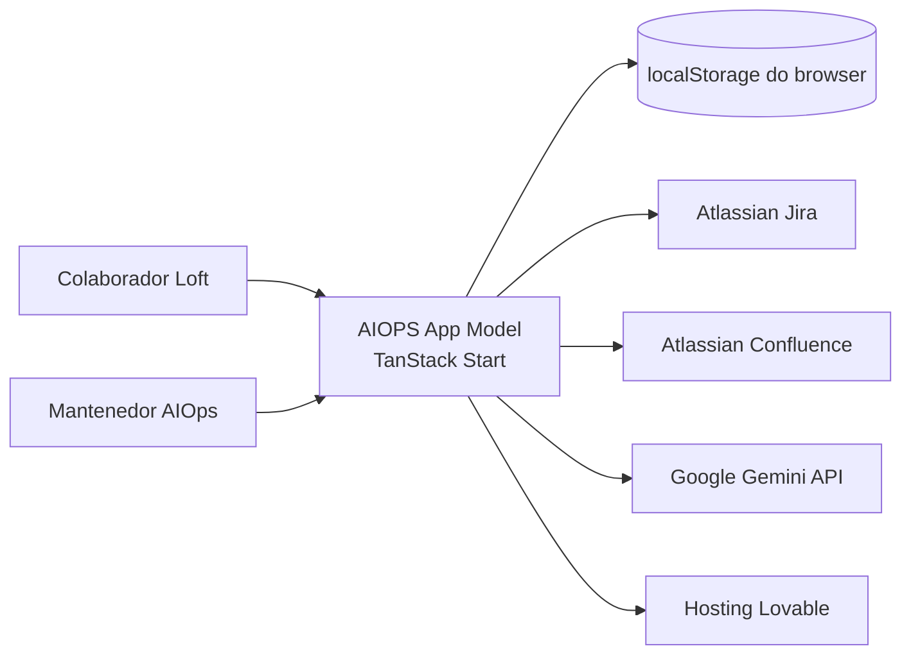

# Contexto do sistema

> Language: [English (EN)](../en/architecture/system-context.md) | Português (pt-BR)
>
> Status: DRAFT
>
> Documentation Standard v1.0 (adopter)

## Propósito

Este documento situa o AIOPS App Model no ecossistema: quem usa, quais sistemas externos são chamados e o que permanece dentro do boundary da aplicação.

## Sistema

| Campo | Valor |
| --- | --- |
| Nome | AIOPS App Model |
| Propósito | Portal interno Loft para descoberta de projetos de IA, visibilidade de impacto e administração de cases |
| Owner | Unknown — preencher na Fase 2 (`operations/service-profile.md`) |
| Resumo do boundary | App web TanStack Start: UI React + server functions/rotas API; catálogo local no browser; chamadas outbound para Atlassian e Gemini |

## Usuários

| Usuário | Necessidade | Interação |
| --- | --- | --- |
| Colaborador Loft | Encontrar projetos, integrações e histórias de impacto | Browser — rotas públicas |
| Mantenedor AIOps / conteúdo | Importar cases do Jira, sync de status no Confluence | Browser — rotas admin |
| Desenvolvedor | Rodar e estender o portal | Dev server local, Git |

## Consumidores

| Consumidor | O que consome | Contrato |
| --- | --- | --- |
| Browser (UI do portal) | Respostas SSR HTML/JS, JSON de server functions | TanStack Start |
| Jira (anexos/avatars) | Respostas binárias proxied | GET `/api/jira-attachment`, `/api/jira-avatar` |

## Sistemas externos

| Sistema externo | Papel | Direção | Classificação |
| --- | --- | --- | --- |
| Atlassian Jira | Busca de projetos/issues, escopo de épico, anexos | outbound | Confirmed |
| Atlassian Confluence | Listar spaces; CRUD de páginas de status em pasta delimitada | outbound | Confirmed |
| Google Gemini | Transformar escopo Jira em rascunho estruturado de case | outbound | Confirmed |
| Lovable | Build/deploy; hook de error reporting | bidirectional | Confirmed |
| Backend FastAPI (`VITE_API_URL`) | Referenciado em `.env.example` | Unknown | Unknown |

## Dependências

| Dependência | Tipo | Propósito | Classificação |
| --- | --- | --- | --- |
| `localStorage` do browser | data | Persistir edições do catálogo | Confirmed |
| Credenciais Atlassian | operacional | Autenticar chamadas Jira/Confluence | Confirmed |
| API key Gemini | operacional | Organização assistida por IA de imports | Confirmed |
| Nitro / Cloudflare (via Lovable) | runtime | SSR e hosting de server functions | Inferred |

## Entradas

| Entrada | Fonte | Formato / contrato |
| --- | --- | --- |
| Catálogo seed | `src/data/*` | Módulos TypeScript |
| Edições / imports do usuário | UI admin, import Jira | Merge em `PortalContentSnapshot` → `localStorage` |
| URL de projeto / escopo Jira | Formulário de import | Body POST de server function |
| Credenciais Atlassian | Ambiente / `.env` | Header Basic auth |

## Saídas

| Saída | Destino | Formato / contrato |
| --- | --- | --- |
| Páginas do portal | Browser do usuário | HTML (SSR) + hidratação client |
| Páginas de status Confluence | Pasta Confluence (`CONFLUENCE_STATUS_FOLDER_ID`) | HTML storage format |
| Rascunhos de case | `localStorage` do browser | Snapshot JSON |
| Bytes de anexo/avatar Jira | UI do portal (img/src) | Resposta HTTP binária |

## Relações relevantes

| De | Para | Relação | Notas |
| --- | --- | --- | --- |
| AIOPS App Model | Jira | chama | Busca, coleta de escopo, proxy de mídia |
| AIOPS App Model | Confluence | chama | Escrita limitada à pasta de status |
| AIOPS App Model | Gemini | chama | Pós-processamento do escopo Jira |
| AIOPS App Model | localStorage | lê/escreve | Catálogo por browser |
| Usuário admin | AIOPS App Model | usa | Sem gate de auth observado |

## Diagrama de contexto

## Documentação relacionada

| Documento | Caminho |
| --- | --- |
| Visão geral da arquitetura | [overview.md](overview.md) |
| Rotas | [../application/routes.md](../application/routes.md) |
| Desenvolvimento local | [../operations/local-development.md](../operations/local-development.md) |
| Visão geral do projeto | [../project-overview.md](../project-overview.md) |
